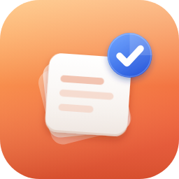
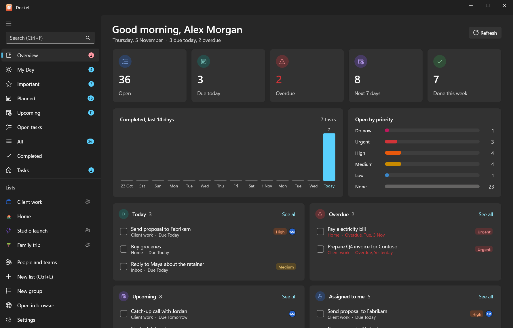
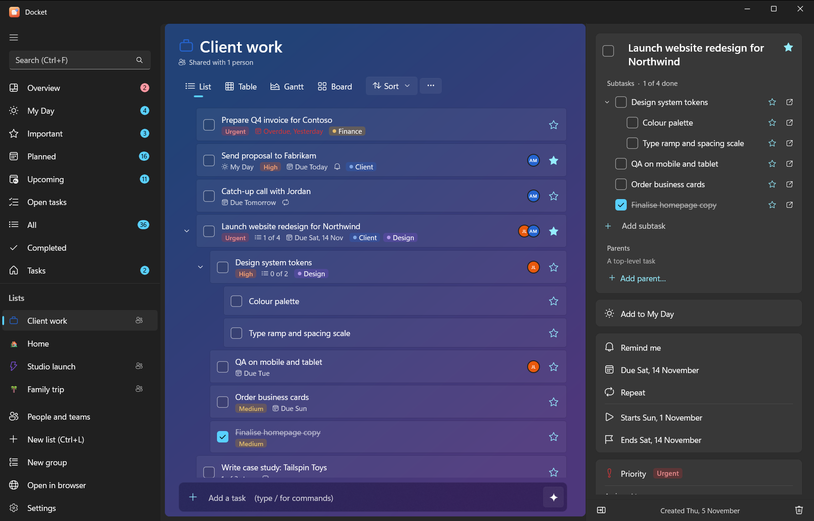

<p align="center"></p>

<h1 align="center">Docket</h1>

<p align="center">A self-hosted to-do app in the style of Microsoft To Do: native Windows and Android apps, a command line,
and a connector that lets AI assistants (Claude, ChatGPT and local models) work on your tasks.</p>

---

Docket keeps your tasks on your own [Vikunja](https://vikunja.io) server, on your PC or on a server you control.
Nobody else holds your data, and every Docket app behaves the same way because they share one core library.

- **My Day** that resets each morning, with suggestions. **Important**, **Planned** grouped by date, **All**, **Completed**.
- **Lists and groups** with icons and backgrounds, and List, Table, Gantt and Board views. Board columns get their own
  colours and icons.
- **Subtasks** nested to any depth (a task can have several parents), **priorities**, an **Overview** dashboard, **Upcoming**.
- **People and teams:** assign tasks, share lists with people, teams or a public link.
- **Add bar commands** (`/s` search, `/x` mark done) and **AI planning** with Ollama on your PC or a Claude, ChatGPT or Gemini key.
- **Tasks** with subtasks, due dates, reminders, repeats (daily, weekdays, weekly, monthly, yearly, every N…), categories,
  files and notes. Quick add: `Send invoice friday !3`.
- **Windows app** (WinUI 3, Fluent), **Android app** (.NET MAUI, matching Fluent design), **web app** in the same style, **`docket` CLI** with JSON output.
- **AI connector** (`docket-mcp`): 26 tools over MCP (local or HTTPS with OAuth) and REST with OpenAPI. It can't delete anything.

<p align="center"> </p>

## Get started

New here? Read [Getting started](docs/index.md). The full documentation is also on the website, under **Docs**.

| I want to… | Do this |
|---|---|
| Use it on my Windows PC | Download the Windows zip from [Releases](https://github.com/niteshaggarwal/docket/releases), run `install.ps1`. [Details](docs/setup/windows.md) |
| Run an always-on server | `deploy/docker/setup.sh` on any Linux box with Docker. [Details](docs/setup/docker.md) |
| Use my phone | Install the Android APK from Releases; sign in with your server's address. [Phone access](docs/setup/phone.md) |
| Use it with an AI | [Claude](docs/ai/claude.md), [ChatGPT](docs/ai/chatgpt.md), [local models](docs/ai/local-ai.md), [other MCP clients](docs/ai/other-clients.md), and the [Claude skill](docs/ai/claude-skill.md) |
| Learn the apps and CLI | [Windows app, Android app, `docket` commands](docs/apps.md), [troubleshooting](docs/troubleshooting.md) |
| Script it | [REST, MCP, CLI and Vikunja API](docs/api.md) |

## AI support at a glance

| Assistant | Connection |
|---|---|
| Claude Desktop, Claude Code | Local connector, set up by the Windows installer |
| claude.ai (web, desktop, mobile) | Custom connector → `https://your-server/mcp`, OAuth |
| ChatGPT | Developer-mode MCP connector (OAuth), or a custom GPT importing `/openapi.json` |
| LM Studio, Ollama + Open WebUI/Jan/Continue | Local connector, fully offline |
| Gemini CLI, VS Code Copilot, Cursor and other MCP clients | Local or remote MCP |

The connector's Vikunja token has no delete rights, and none of its tools delete, so an assistant can't destroy your
data by mistake. [How it works](docs/ai/README.md).

## Repository layout

```
src/Docket.Core       Vikunja client and all task behaviour (My Day, steps, repeats, quick add, formatting)
src/Docket.App        Windows app (WinUI 3)
src/Docket.Mobile     Android app (.NET MAUI); see ANDROID.md
src/Docket.Cli        docket command-line tool, Windows reminder notifications
src/Docket.Mcp        docket-mcp AI connector: MCP (stdio/HTTP), REST + OpenAPI, OAuth
tests/                Unit tests for Docket.Core
deploy/windows        install.ps1, setup-tokens.ps1, uninstall.ps1
deploy/docker         compose.yaml, Caddyfile, setup.sh
build/                publish-windows.ps1 (release layout)
docs/                 Self-hosting, AI guides, API reference
design/icon           Icon masters and exports
site/                 The project website (one static page; works on GitHub Pages)
tools/                Smoke tests and dev helpers
```

## Build from source

Needs the [.NET 10 SDK](https://dotnet.microsoft.com/download). Windows for the app and CLI; any OS for Core,
tests and the connector. Android: see [ANDROID.md](ANDROID.md).

```sh
dotnet test tests/Docket.Core.Tests
dotnet run --project src/Docket.Mcp -- --help
```

```powershell
dotnet build src\Docket.App -p:Platform=x64           # Windows app
.\build\publish-windows.ps1 -Version 0.3.0 -Zip       # release zip: app, CLI, connector, installer
node tools\http-smoke.mjs http://localhost:8080 KEY   # end-to-end test of a running connector (read-only)
```

Testing tip: every Docket tool reads `DOCKET_SETTINGS` (path to another settings.json) when set, so tests never touch
your real settings. `tools/mcp-smoke.mjs` changes tasks, so run it against a test account.

## Contributing and support

- Questions and ideas: [Discussions](https://github.com/niteshaggarwal/docket/discussions). Bugs: [Issues](https://github.com/niteshaggarwal/docket/issues).
- [CONTRIBUTING.md](CONTRIBUTING.md) explains how to build, test and send a change.
- Security problems: please report privately; see [SECURITY.md](SECURITY.md).

## Licence

[AGPL-3.0](LICENSE). Copyright © 2026 Quartifex. Third-party components and assets: [NOTICE.md](NOTICE.md).
Docket is an independent project and isn't affiliated with Vikunja, Microsoft, Anthropic or OpenAI.
