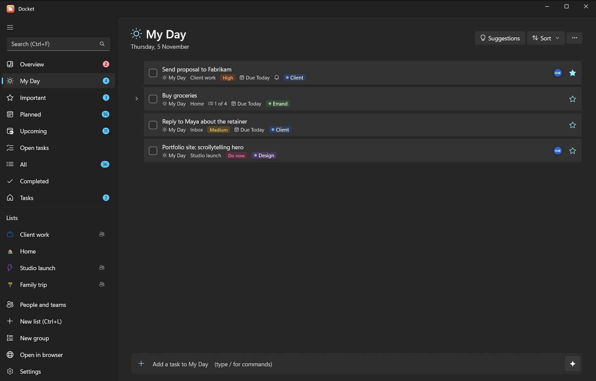
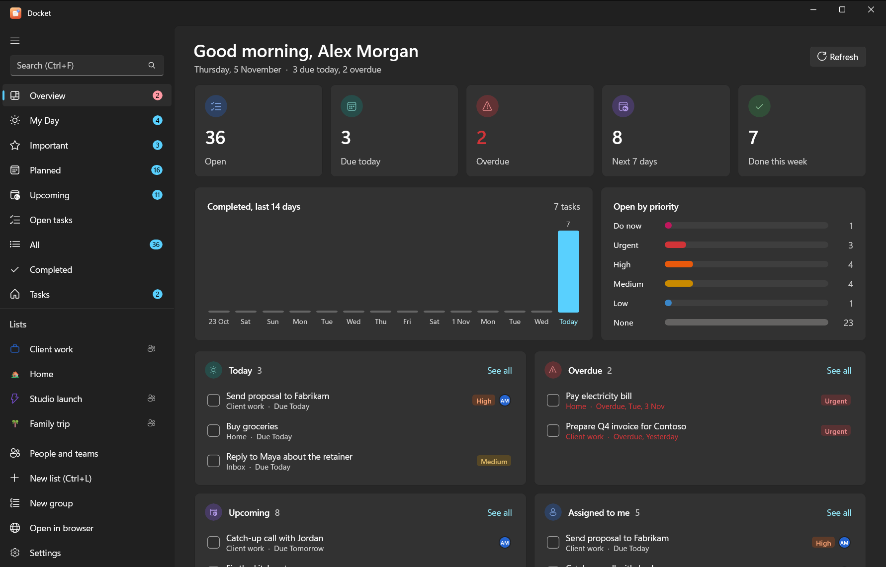

# Getting started

Docket is a free, open-source to-do app in the style of Microsoft To Do. Your tasks live on your own server, on your
PC or on a machine you control, and you reach them from Windows, Android, a browser, the command line and AI
assistants such as Claude and ChatGPT.

## What Docket is

Docket is a set of apps on top of [Vikunja](https://vikunja.io), an open-source task server. Vikunja stores your tasks;
Docket gives you the familiar Microsoft To Do way of working with them: **My Day**, **Important**, **Planned**,
lists and groups, subtasks, reminders, repeats and boards.

Nobody else holds your data. Docket talks only to the server you sign in to and sends nothing to its developers.

## The pieces

| Piece | What it is | Runs on |
|---|---|---|
| **Docket for Windows** | The main app (WinUI 3, Fluent design) | Windows 10 and 11 |
| **Docket for Android** | The same features on your phone (.NET MAUI) | Android |
| **Docket web** | Vikunja's own web app, reskinned to look like Docket | Any browser, at `http://localhost:3457` on Windows |
| **`docket` CLI** | Your tasks from a terminal, with JSON output for scripts | Windows |
| **`docket-mcp` connector** | Lets AI assistants read and change your tasks (it can't delete) | Windows, macOS, Linux, Docker |
| **Vikunja** | The task server that stores everything | Your PC, a home server or a VPS |

Every Docket app shares one core library, so My Day, repeats, quick-add words and subtasks behave the same everywhere.

## Pick your path

- **[Just me, on my Windows PC](setup/windows.md)** One installer sets up the server, the app, the CLI and the AI
  connector. No admin rights needed. Add your phone later with [Tailscale](setup/phone.md).
- **[An always-on server](setup/docker.md)** One script on any Linux machine with Docker. You get HTTPS, the web app,
  and a connector that claude.ai and ChatGPT can reach.
- **[I already run Vikunja](setup/existing-vikunja.md)** Point the Docket apps and connector at your server.

Not sure? Start with the Windows PC. You can move to a server later by [backing up and restoring](setup/backups.md).
The [setup overview](self-hosting.md) compares the options in more detail.

## Five-minute quick start (Windows)

1. Download `docket-<version>-windows-x64.zip` from the
   [latest release](https://github.com/niteshaggarwal/docket/releases/latest) and unzip it anywhere.
2. Right-click `install.ps1` and choose **Run with PowerShell**.
3. Type your time zone when asked (for example `Europe/London` or `Asia/Kolkata`).
4. Your browser opens. Create your account there, go back to the PowerShell window and press <kbd>Enter</kbd>.
5. Sign in once more in the window with the same username and password. Docket makes its own keys (tokens) from
   that sign-in; your password isn't stored.
6. Answer **Y** to close sign-ups, so nobody else can make an account.
7. Open **Docket** from the Start menu and add your first task, for example `Send invoice friday !3`.

That's it. The [Windows guide](setup/windows.md) explains every step and prompt, and what was installed where.

> [!TIP]
> Type `/` in the add bar at the bottom of a list to see the commands: `/s` search, `/x` mark done, `/m` add to
> My Day, `/i` star, `/ai` plan with AI. See [quick add and commands](using/quick-add.md).

## Next steps

- Learn the [Windows app](using/windows.md), the [Android app](using/android.md) or the [CLI](using/cli.md).
- Connect an AI: [Claude](ai/claude.md), [ChatGPT](ai/chatgpt.md) or a [local model](ai/local-ai.md). Then add the
  [Docket skill for Claude](ai/claude-skill.md) so Claude knows how to work with your tasks.
- Share lists and assign tasks: [people, teams and sharing](using/people-and-sharing.md).
- Something not working? See [troubleshooting](troubleshooting.md) and the [FAQ](faq.md).
