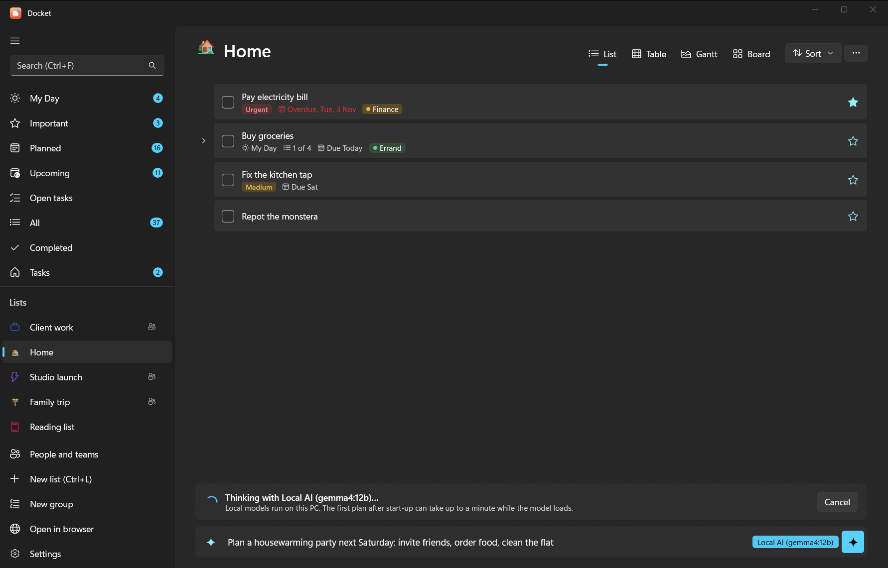
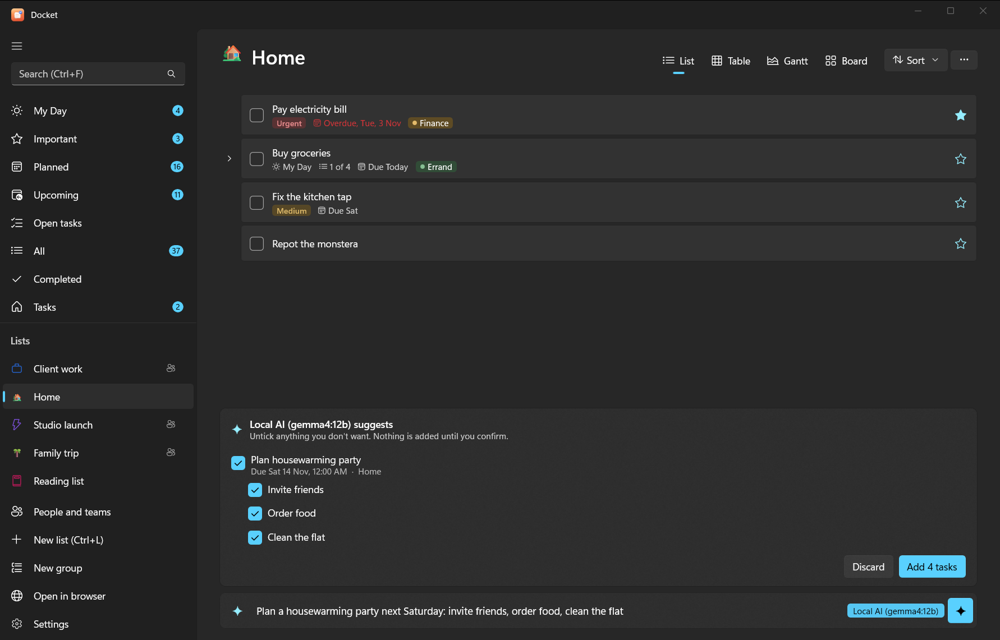

# AI planning in the app

Describe what you need in plain words, and Docket's AI turns it into tasks, with subtasks, dates and priorities. You
see the whole plan first; nothing is added until you confirm it.

This is the AI **inside** the Docket apps. To let an assistant like Claude or ChatGPT work on your tasks from its own
app, see [AI assistants](../ai/README.md) instead.

## Use it

- In the add bar, type `/ai` and what you need, for example
  `/ai plan the product launch next week: venue, invites, press kit`.
- Or turn on the **sparkle** button in the add bar, and just type.
- Or from the command line: `docket ai "plan the launch next week"` shows the plan; run it again with `--yes` to add it.

The AI keeps your own words and names, only sets dates you gave or clearly implied, breaks big jobs into subtasks,
and can put things in My Day or mark them important. You can paste a messy list or meeting notes too.

## Choose an AI

Open **Settings > AI** and pick a provider:

| Provider | What you need | Where your text goes |
|---|---|---|
| **Local** | [Ollama](https://ollama.com) on your PC and a downloaded model | Nowhere: it stays on your PC |
| **Claude** | An API key from [console.anthropic.com](https://console.anthropic.com) | Anthropic |
| **ChatGPT** | An API key from [platform.openai.com](https://platform.openai.com) | OpenAI |
| **Gemini** | An API key from [aistudio.google.com](https://aistudio.google.com) | Google |
| **Off** | Nothing | The add bar adds tasks exactly as typed |

Then choose **Test: plan "Buy milk tomorrow"** to check it works.

API keys are stored encrypted for your Windows account (on Android, in the system's secure storage) and only ever
sent to that provider. API use is billed by the provider, separately from any Claude or ChatGPT subscription; a
planning request is small.

### Default models

| Provider | Default model | Change it |
|---|---|---|
| Local (Ollama) | `qwen2.5:7b`, or another chat model you have installed | Pick from the **Model** list |
| Claude | `claude-haiku-5-5` | Type another model name in **Model** |
| ChatGPT | `gpt-4.1-mini` | Same |
| Gemini | `gemini-2.5-flash` | Same |

## Set up local AI with Ollama

Local AI is free and private, but needs a reasonably capable PC: a 7–8B model wants about 8 GB of free memory, and
runs much faster with a recent graphics card.

1. In **Settings > AI**, choose **Local**. Docket checks for Ollama.
2. If it says **Ollama isn't installed**, choose **Install Ollama**. Docket installs it for your account with the
   Windows Package Manager (winget); a window shows the progress. You can also install it yourself from
   [ollama.com](https://ollama.com/download).
3. If it says **Ollama is installed but not running**, choose **Start Ollama** (it then runs from the system tray).
4. When it says **Local AI is running** but no model is installed, type a model name (the box suggests
   `qwen2.5:7b`) and choose **Download model**. It's several GB and stays on your PC.
5. Choose the model in the **Model** list, then **Test**.

The first answer after starting can take up to a minute while the model loads. Good small models for planning:
`qwen2.5:7b`, `qwen3:8b`, `llama3.1:8b`. Very small models (under about 4B) make messier plans.

From a terminal, the same is `winget install Ollama.Ollama` and `ollama pull qwen2.5:7b`.

## On Android

The phone uses the same choices. **Local AI on your PC** reaches Ollama over your network, by default at your
Docket server's address on port 11434 (you can change it in Settings > AI). For that to work:

1. Make Ollama listen on the network, not only on the PC: set the Windows environment variable
   `OLLAMA_HOST` to `0.0.0.0` (Settings > System > About > Advanced system settings > Environment Variables), then
   quit and restart Ollama from the tray.
2. If Windows Firewall asks, allow Ollama on **private** networks.
3. With Tailscale, the phone reaches the PC at its Tailscale name, so the default address works.

> [!WARNING]
> `OLLAMA_HOST=0.0.0.0` lets other devices on your network use Ollama. That's fine at home or on Tailscale; don't
> do it on public Wi-Fi.

## When it doesn't answer

See [troubleshooting: AI planning doesn't respond](../troubleshooting.md#ai-planning-doesnt-respond).
