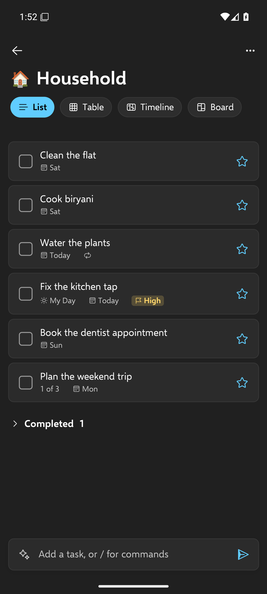
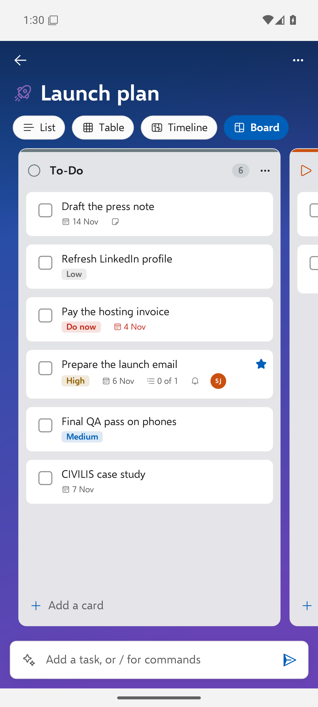

# The Android app

Docket for Android has the same features as the Windows app, in the same Fluent design, and works with the same
tasks.

## Install and sign in

1. Install the APK from [Releases](https://github.com/niteshaggarwal/docket/releases) (allow installing from your
   browser or file manager when Android asks), or from the Play Store once Docket is listed there.
2. Open Docket and enter your **server address**:
   - Windows install: the Tailscale address of your PC, like `https://my-pc.tail1234.ts.net`
     ([set it up](../setup/phone.md));
   - Docker server: `https://your-domain`;
   - your own Vikunja: its address.
3. Enter your Vikunja username and password. Docket makes a token for the phone; your password isn't stored.

## Everyday use

- **Home** shows search, the smart lists with counts, and your lists and groups.
- **Add a task** with the add bar; [quick-add words and commands](quick-add.md) work, including `/ai`.
- **Swipe right** on a task to add it to My Day; **swipe left** to delete it.
- **Tap a task** to open it: subtasks, checklist, My Day, reminder, due date, repeat (including custom),
  priority, categories, assignees, list, files (open and add), notes, delete.
- **My Day suggestions**, **Planned** grouped by date, sorting and a completed section work as on Windows.
- **Views:** List, Table, Timeline (the phone's Gantt) and Board for every list.
- **Lists:** rename, delete, icon, background, share.
- **Theme:** light, dark or system.

## People and sharing

Share lists with people and teams and assign tasks, as on Windows
([people, teams and sharing](people-and-sharing.md)). Creating brand-new **local accounts** for people is done from
the Docket app on the PC that runs your server.

## Reminders

Reminders become Android notifications. They're scheduled each time you open Docket, so open the app now and then
after adding reminders elsewhere (on the PC or through an AI). Allow notifications when Android asks; on some phones
you also need to allow **alarms and reminders** and turn off battery optimisation for Docket.

## AI planning

Settings > AI offers the same choices as Windows: **Local AI on your PC** (Ollama, over your network), **Claude**,
**ChatGPT**, **Gemini** (with your API key, stored in Android's secure storage) or **Off**. See
[AI planning](ai-planning.md#on-android).

## Building it yourself

The app is .NET MAUI in `src/Docket.Mobile`. Build notes and the Play Store checklist: [ANDROID.md](../../ANDROID.md).
