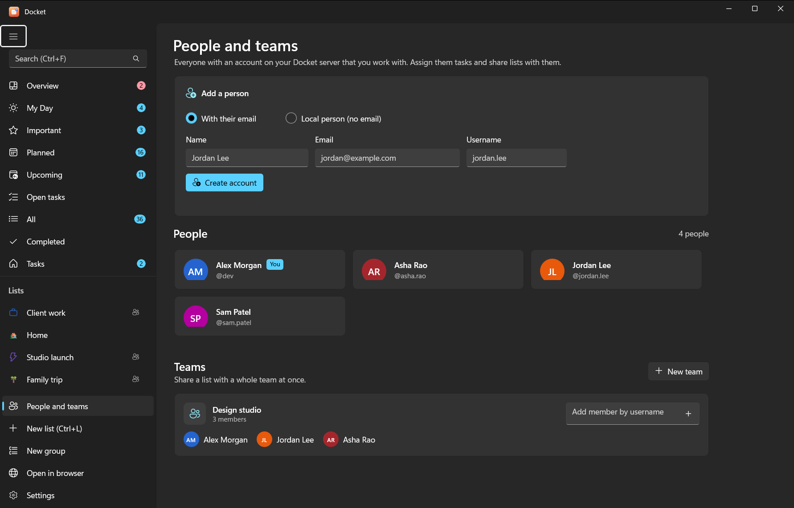
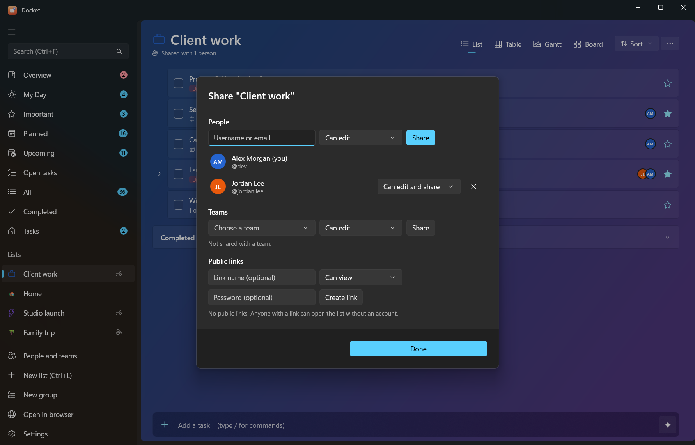

# People, teams and sharing

Docket lists can be shared, and tasks can be assigned to people. Everyone is an account on your own Docket server,
so nothing goes through anyone else's cloud.

<p class="shots"></p>

## Add people

Open **People and teams** in the sidebar.

- **Someone who already has an account** on your server: share a list with them (below) and they appear here.
- **A new person**: fill in **Name**, **Email** and **Username** under **Add a person** and choose **Create account**.
  Docket shows a password **once**; send it to them with the server address so they can sign in to Docket (or Docket
  web) and change it.

Creating accounts works when the server runs on the same PC as the app (the Windows install). For a Docker server,
let people sign up while sign-ups are open, or create accounts with Vikunja's own tools.

## Teams

A team groups people so you can share a list with all of them at once. On the People page choose **New team**, name
it and add members by username.

## Share a list

Open the list's **List options > Share list…**. You can share with:

| Who | How |
|---|---|
| A person | Type their username or email |
| A team | Choose the team |
| Anyone with a link | **Public link**, optionally with a password; no account needed |

Each person or team gets a permission:

| Permission | They can |
|---|---|
| Can view | See the list and its tasks |
| Can edit | Add, change and complete tasks |
| Can edit and share | All of that, and share the list with others |

Shared lists show a sharing icon. Change someone's permission or **stop sharing** from the same dialog.

## Assign tasks

In a task's details, **Assign to** picks someone who can see the list. Assigning someone who can't see it yet shares
the list with them first. Assigned tasks show their avatars on the row, and **Overview** lists what's assigned to you.

From the command line:

```powershell
docket people                    # who you work with
docket assign 12 pat             # assign task 12 to pat
docket unassign 12 pat
docket share work                # who can see the Work list
docket share work pat edit       # share it with pat (view, edit or admin)
```

## What AI can and can't do

An AI connected through the Docket connector can list people (`people`) and assign a task to someone who can
**already** see its list (`assign`). It can't share lists, manage teams or create accounts: its token has no
sharing rights, on purpose. Share from the app first, then ask the AI to assign.
