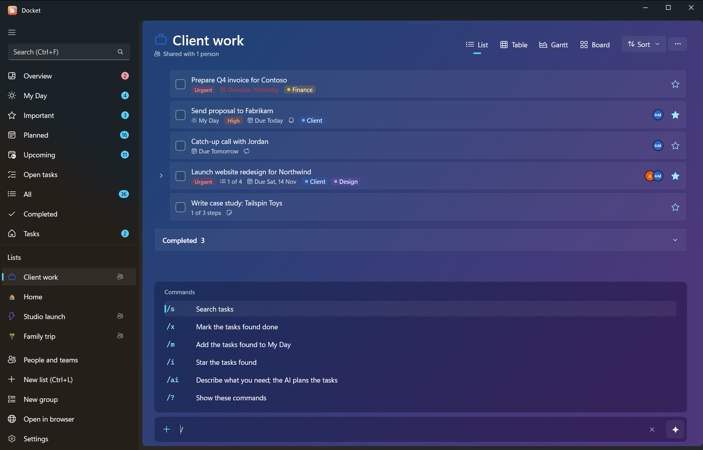
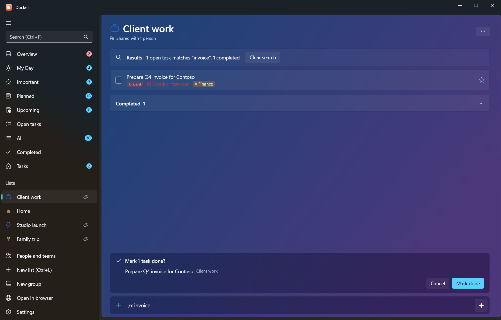

# Quick add and commands

The add bar at the bottom of every list does three things: adds tasks, understands a few quick-add words, and runs
commands that start with `/`. It works the same in the Windows and Android apps, and the same words work in the CLI
and through the AI connector.

## Quick-add words

Type a task with a word or two for its date and priority. The words are taken out of the title.

| Type | Sets |
|---|---|
| `today` | Due today |
| `tomorrow` | Due tomorrow |
| a weekday: `monday` … `sunday`, or `mon`, `tue`, `wed`, `thu`, `fri`, `sat`, `sun` (also `on friday`) | Due on the next one (today's weekday means next week) |
| `in 3 days` | Due in that many days |
| `20/11` | Due on that day and month (day first). A date already past this year means next year |
| `!1` to `!5` | Priority: 1 low, 2 medium, 3 high, 4 urgent, 5 do now |

Quick-add due dates are set for 6 pm that day. Examples:

| You type | You get |
|---|---|
| `Send invoice friday !3` | "Send invoice", due Friday, high priority |
| `Call the bank tomorrow` | "Call the bank", due tomorrow |
| `Renew passport in 30 days !4` | "Renew passport", due in 30 days, urgent |
| `Dentist 20/11` | "Dentist", due 20 November |

Only one date is used, and the words must stand alone (`today's` is left as it is). To set a time, reminder,
repeat or star, open the task after adding it.

## Slash commands

Type `/` in the add bar to see the commands. Commands that act on tasks search first, show you what they found and
ask you to confirm.

| Command | Also | What it does |
|---|---|---|
| `/s words` | `/search` | Search tasks |
| `/x words` | `/done` | Mark the tasks found done |
| `/m words` | `/myday` | Add the tasks found to My Day |
| `/i words` | `/star` | Star the tasks found (Important) |
| `/ai what you need` | | Ask the AI to plan tasks ([AI planning](ai-planning.md)) |
| `/?` | `/help`, `/` | Show the commands |

For example: `/x invoice` finds every open task with "invoice" and, after you confirm, marks them done.
`/m report` puts all your report tasks in My Day.

## The sparkle button

The add bar has a **sparkle** button for AI. Turn it on and everything you type goes to the AI as a request, as if it
started with `/ai` (choose an AI in **Settings > AI** first). Turn it off to add tasks exactly as typed.
