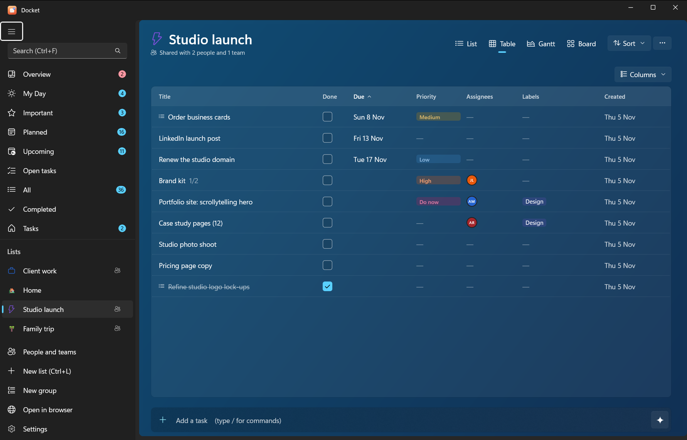
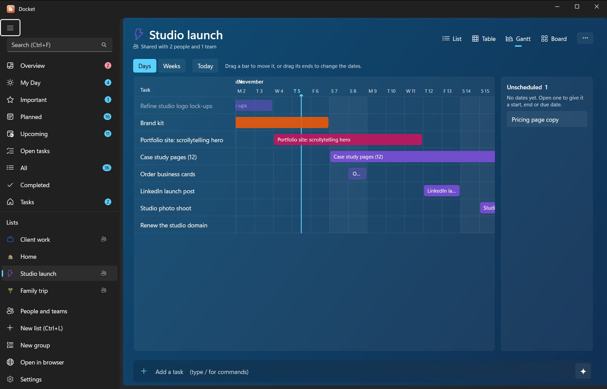
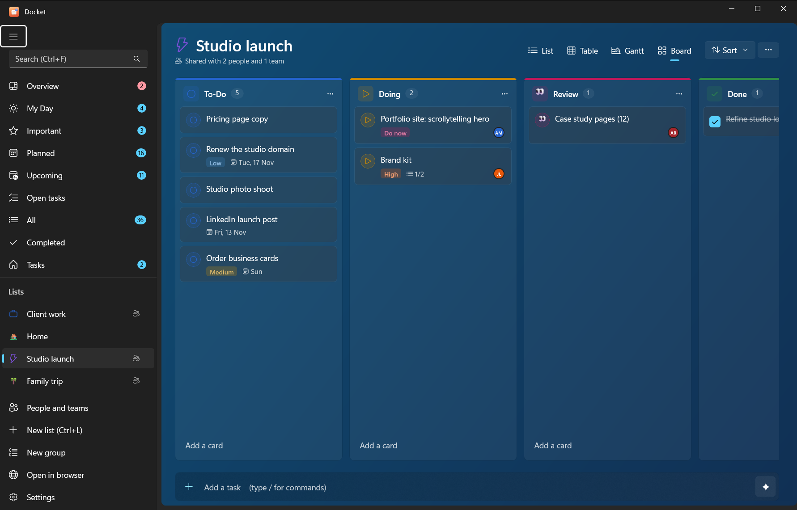
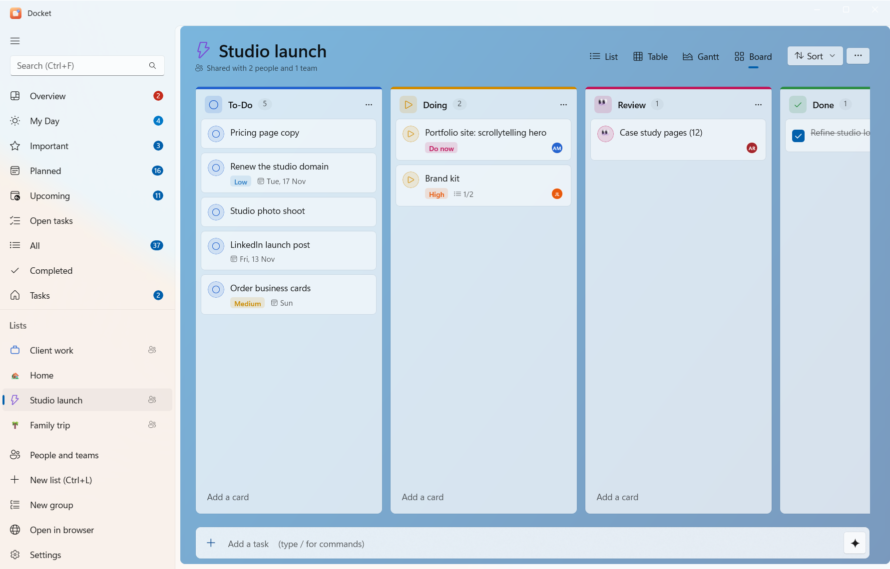
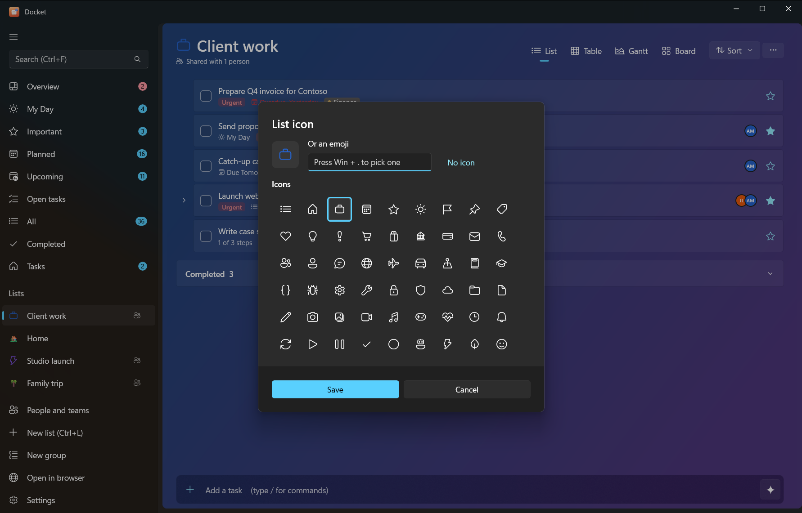
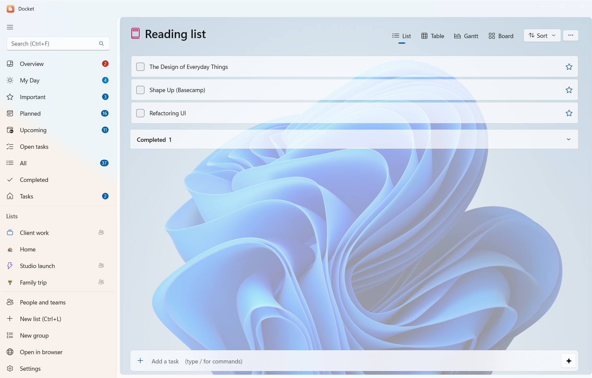

# Views, boards and list styles

Every list can be shown four ways, and each list can have its own icon and background.

## Four views of every list

Switch with the view buttons at the top of a list. Each list remembers its view.

| View | Good for |
|---|---|
| **List** | The everyday To Do view, with subtasks nested under their parents |
| **Table** | Many tasks at once, with columns for dates, priority and more |
| **Gantt** | Seeing work over time, using start and end dates (called **Timeline** on Android) |
| **Board** | Moving work through stages, Kanban style |

## Boards

Every list has a board with **To-Do**, **Doing** and **Done** columns to start with.

- **Add column** at the end of the board makes a new one; add as many as you like.
- Each column's menu lets you **rename** it, pick a **colour** and an **icon** (a Fluent glyph or an emoji), or
  delete it.
- **To-Do** and **Done** always stay (you can rename them). Moving a card into **Done** completes the task.
- **Add a card** at the bottom of a column adds a task straight into it. Drag cards between columns.

From the command line: `docket board work` shows a board and `docket move 12 doing` moves a task. An AI can use
`get_board` and `move_task`.

## List icons and backgrounds

Open **List options** (the **…** at the top of a list):

- **Icon…** sets the list's icon: a Fluent glyph or any emoji. It shows in the sidebar and the list's title.
- **Background…** gives the list a backdrop: a **colour**, a **gradient** (with an angle), the **accent** colour, or
  an **image** from your PC.
- **Colour** sets the list's colour in the sidebar.

## Sorting and filtering

At the top of a list: **Sort** by my order, importance, due date, priority, alphabetically or creation date; show or
hide completed tasks; search within the list; and **Copy list** to paste it as text anywhere.

## Overview and Upcoming

- **Overview** is a dashboard of all your lists: how many tasks are open, due today and overdue, the last 14 days,
  tasks by priority, what's assigned to you and progress per list. `docket overview` and the AI tool `overview`
  give the same numbers.
- **Upcoming** shows what's due in the coming days, day by day.
- **Open tasks** shows everything unfinished across all lists.
