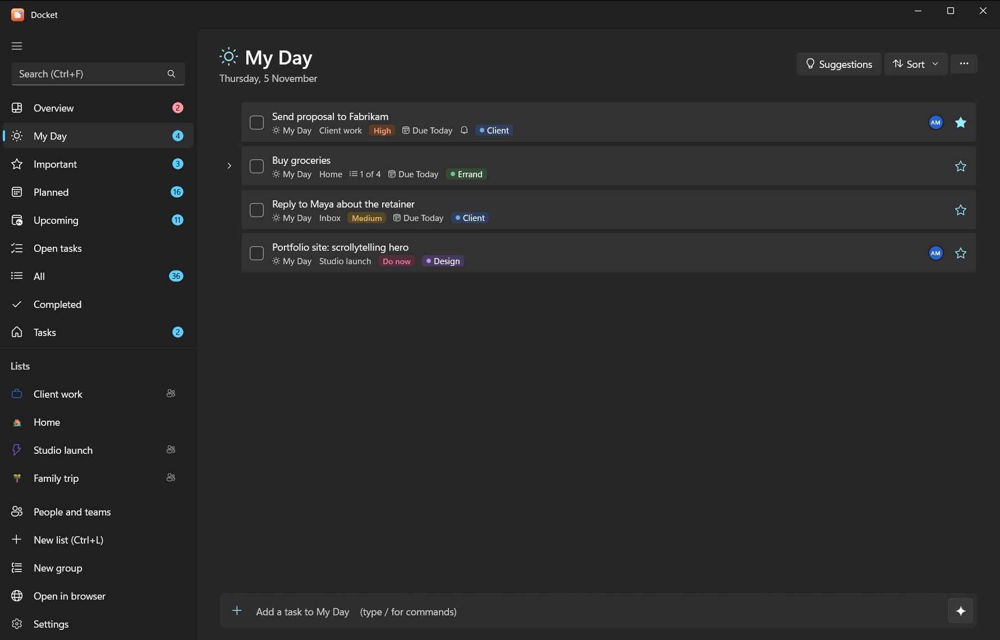
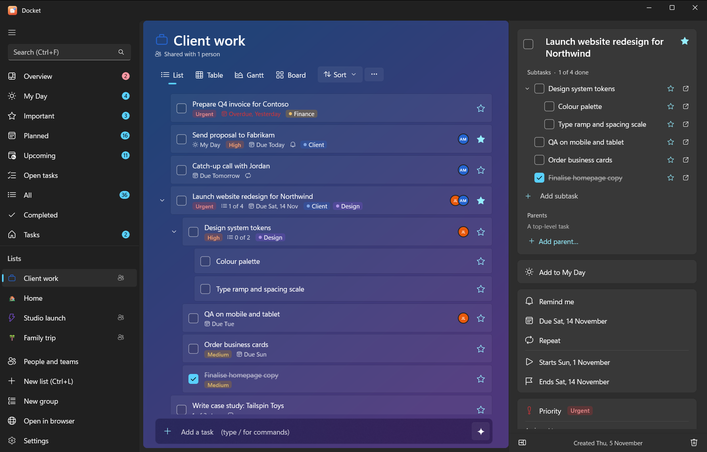
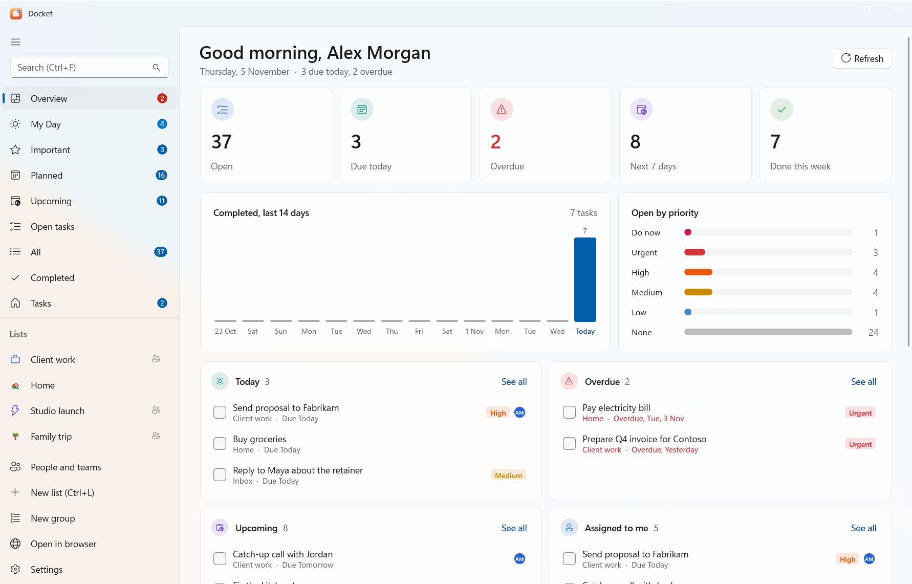
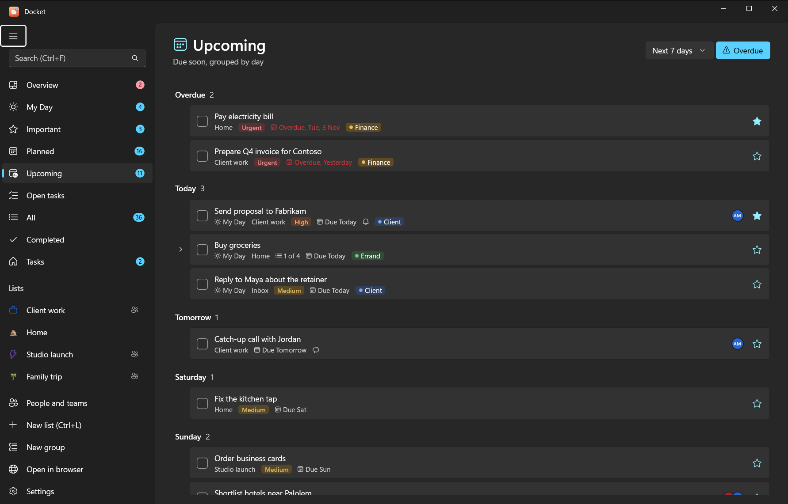

# The Windows app

Docket for Windows works like Microsoft To Do, with subtasks, boards, people and AI added. Open it from the Start
menu (**Docket**). If you haven't installed it yet, see [install on a Windows PC](../setup/windows.md).

<p class="shots"></p>

## The sidebar

The left side has your **smart lists** at the top and **your lists** underneath.

| Smart list | What's in it |
|---|---|
| **My Day** | Tasks you picked for today. It starts empty each morning. **Suggestions** offers overdue, due and recently added tasks |
| **Important** | Starred tasks |
| **Planned** | Tasks with a due date, grouped Earlier, Today, Tomorrow, This week and Later |
| **All** | Every open task |
| **Completed** | Finished tasks |
| **Tasks** | Your default list (Inbox) |
| **Overview** | A dashboard: counts, the last 14 days, priorities, today, overdue, upcoming, assigned to you and progress per list |
| **Upcoming** | What's due soon, day by day |
| **Open tasks** | Everything unfinished, across all lists |

Hide the ones you don't use in **Settings > Smart lists** (there's also "Hide empty smart lists automatically").

<p class="shots"></p>

## Lists and groups

- **New list:** **New list** at the bottom of the sidebar, or <kbd>Ctrl</kbd>+<kbd>L</kbd>. **New group** makes a group.
- **Groups** hold several lists (in Vikunja they're parent projects).
- **List options** (the **…** button at the top of a list) has **Rename list**, **Colour**, **Move to group**,
  **Icon…**, **Background…**, **Share list…**, **Show completed tasks**, **Copy list** and **Delete list**.
- **Drag a task onto a list** in the sidebar to move it there. Drag tasks up and down to reorder them when the list is
  sorted by "My order".

Lists can look the way you like, with an icon and a background: see [views, boards and list styles](views-and-boards.md#list-icons-and-backgrounds).

## Adding tasks

The **add bar** sits at the bottom of every list. Type and press <kbd>Enter</kbd>. Quick-add words set the due date
and priority as you type:

```text
Send invoice friday !3
Call the bank tomorrow
Renew passport in 3 days !5
```

Type `/` for commands: `/s` search, `/x` mark matches done, `/m` add them to My Day, `/i` star them, `/ai` plan with
AI. Everything about the add bar: [quick add and commands](quick-add.md).

## Task details

Click a task (or press <kbd>Enter</kbd>) to open the details pane on the right. There you can set:

- **Subtasks** (**Add subtask**) and **Parents** (**Add parent…**); see below
- **Checklist**: the older steps, with **Turn into subtasks**
- **Add to My Day** and **Important** (the star)
- **Set priority**: none, low, medium, high, urgent or do now
- **Add start date**, **Add end date**, **Add due date** and **Remind me**
- **Repeat**: daily, weekdays, weekly, monthly, yearly or custom (every N days, weeks, months or years)
- **Assign to**: people who can see the list ([people and sharing](people-and-sharing.md))
- **Categories**: coloured labels (type a new one and press <kbd>Enter</kbd>)
- **Add file**: attach and open files
- **List**: move the task to another list
- **Add note**
- **Activity**: who created it and when, when it last changed and when it was completed

**Delete task** is at the bottom of the pane, with **Undo** for a few seconds afterwards. (Settings > General >
"Confirm before deleting" asks first.) <kbd>Esc</kbd> hides the pane.

Small icons on each task row show what it has: notes, files, reminders, repeats, subtask progress, priority and
assignees.

## Subtasks and steps

**Subtasks** are full tasks of their own: each has its own star, dates, reminders and subtasks, and they nest as
deep as you need. A task can even sit under **several parents** (for example "Book venue" under both "Launch party"
and "Q4 budget").

- Add one in the details pane under **Subtasks** (**Add subtask**; quick-add words work), or with the CLI:
  `docket sub 12 "Book the venue friday"`.
- Put an existing task under another with **Parents > Add parent…**, or `docket parent 15 12`.
- Expand or collapse subtasks with the arrow next to a task, or <kbd>→</kbd> and <kbd>←</kbd>.

**Steps** (the **Checklist**) are the simple list inside a task, like Microsoft To Do's. Turn them into subtasks
with **Turn into subtasks** in the details pane, or `docket convert <id>`.

## Views and boards

Each list can be shown as a **List**, **Table**, **Gantt** chart or **Board**, with the view buttons at the top of
the list. Boards have columns you can name, colour and give an icon. See
[views, boards and list styles](views-and-boards.md).

At the top of a list you can also **sort** (my order, importance, due date, A–Z or creation date), **show or hide
completed tasks**, **search**, and **copy the list as text**.

## People, teams and sharing

The **People and teams** page (in the sidebar) lists everyone you work with. Add people, make teams, share lists and assign
tasks: see [people, teams and sharing](people-and-sharing.md).

## AI planning

Describe what you need ("plan the launch next week") and the AI drafts a nested plan for you to check before
anything is added. Turn it on in **Settings > AI**: local with Ollama, or Claude, ChatGPT or Gemini with your own
key. See [AI planning in the app](ai-planning.md).

## Reminders

Reminder pop-ups come from the Docket notifier, which runs in the background so they arrive even when the app is
closed. They have **Complete** and **Snooze 10 min** buttons; clicking one opens the app.

- Installed with `-Reminders`? It starts at sign-in already.
- Otherwise start it with `docket notify --watch`, or run the installer again with `-Reminders`.
- **Settings > Reminders** can play a sound.

Not seeing them? See [troubleshooting](../troubleshooting.md#reminders-dont-pop-up).

## Settings

| Section | What's there |
|---|---|
| General | Confirm before deleting, where new tasks from smart lists go, theme (light, dark or system) |
| AI | Provider (Local, Claude, ChatGPT, Gemini or Off), model, API key, a test button |
| Smart lists | Show or hide Important, Planned, All, Completed; hide empty ones |
| Reminders | Sound on or off |
| Connection | Server address and API token, **Test and save** |
| Keyboard shortcuts | The full list ([shortcuts](shortcuts.md)) |

## Open in browser

**Open in browser** opens [Docket web](web.md) (`http://localhost:3457`) when it's running, or the server otherwise.

## If the server isn't running

When the task server on your PC has stopped, the app starts it again and carries on; you'll see
"Starting your task server…" for a few seconds. If it can't, it offers **Start server and retry**. See
[if the server stops](../setup/windows.md#if-the-server-stops).

## Repeats that only Docket understands

Weekdays, yearly, and every-N-months or every-N-years repeats are handled by Docket itself (shown with a "↻"
category). They move to the next date when you complete them in Docket, the CLI, Android or through the AI
connector, but not in Vikunja's own web app. Daily, weekly, monthly and every-N-days or weeks repeats work everywhere.
